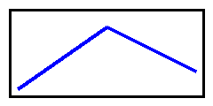

# Abstract

We study the convergence of gradient descent on smooth convex functions and
give a simple bound.

# 1 Introduction {#sec-intro}

Let $f:\mathbb{R}^n\to\mathbb{R}$ be convex and $L$-smooth [1]. The update is

$$x_{k+1} = x_k - \eta \nabla f(x_k), \qquad \eta \le \frac{1}{L}.$$

Our contributions are:

1. A tight bound $f(x_k)-f^\star \le \frac{L\|x_0-x^\star\|^2}{2k}$.
2. Experiments on **three** datasets, see Table 1 and Figure 1.

The method is old[^1] and is described in [the textbook](https://example.org/book).

# 2 Results

Table: Table 1: Accuracy and time of each method.

| Method | Accuracy | Time (s) |
|:-------|---------:|---------:|
| GD     | 91.2     | 10.3     |
| SGD    | 92.8     | 4.1      |

{width=3in}

- A bullet with *italic* text and `inline code`.
- A second bullet that refers back to [the introduction](#sec-intro).

```
def step(x, grad, eta):
    return x - eta * grad(x)
```

# References

[1] Y. Nesterov. Introductory Lectures on Convex Optimization. Springer, 2004.

[2] S. Boyd and L. Vandenberghe. Convex Optimization. Cambridge University Press, 2004.

[^1]: It goes back to Cauchy (1847).
